<h1 align="center">SynapseWrite</h1>
<p align="center"><b>A word processor that is one neural network.</b><br>Nobody trained it. Every weight was written on purpose.</p>

<p align="center">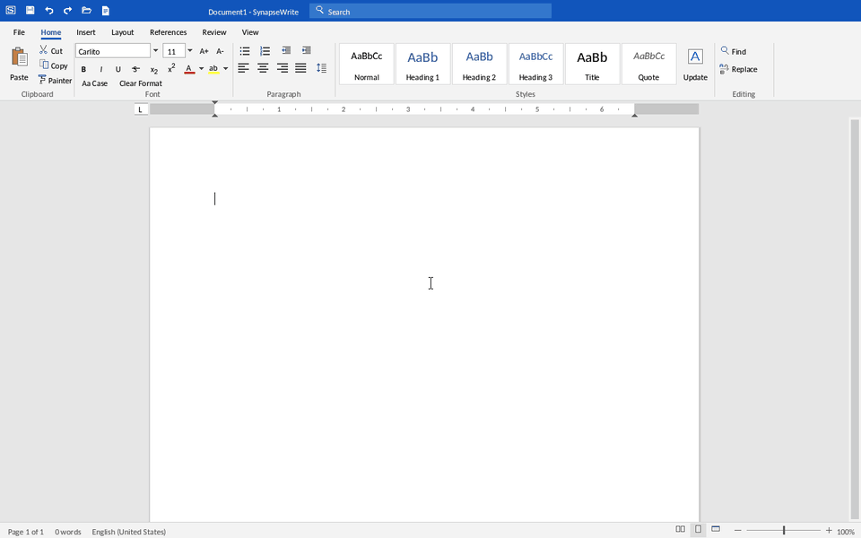</p>

<p align="center"><i>Recorded from the real app through real browser events. The page is only a canvas and a hidden text field for phone keyboards. No HTML layout, CSS styling, canvas drawing or font API makes this image: the network outputs an RGBA tensor, and the glue displays it.</i></p>

| | |
|---|---|
| **Neurons** | 237,522, in 93 named sub-networks (one is currently empty) |
| **Connections** | 1,067,154: 461,199 that push values and 605,955 that are read lazily |
| **Depth** | 187 layers: 152 in the main clock domain and 35 in the second |
| **Control states** | 4,653 one-hot state neurons |
| **Non-network code at run time** | 81 lines of glue, 140 lines of inference engine |
| **Deployment** | one static HTML file, about 2.9 MB |
| **Training code** | none: no data, loss, gradient, search or fitting |

SynapseWrite was built in the spirit of [Weight-Space Programming](https://rikiyat.github.io/blog/weight-space-programming/): reason about what each layer must compute, then write the weights that compute it. Here, a language model wrote a deterministic Python generator, and the generator writes the weights. See [How do we classify what this is?](#how-do-we-classify-what-this-is) for how far that label fits. After that, Python is gone. The browser runs inference, plus the small glue described below.

It is an independent project with its own name and icons, modeled on the features and look of Microsoft Word. It is not affiliated with or endorsed by Microsoft and contains no Microsoft assets.

## Contents

- **[Start here](#start-here)**: [The goal](#the-goal-that-started-it) · [Build it](#build-it) · [Status](#status)
- **[How it works](#how-it-works)**: [One tick](#the-whole-program-is-one-function) · [The equation](#the-equation-explained) · [Neurons to logic](#from-neurons-to-logic) · [Control flow](#control-flow-a-token-in-the-weights) · [Sparsity](#why-half-a-million-neurons-can-feel-instant) · [Memory](#memory-the-network-holds-the-pointers) · [The screen](#the-screen-is-also-an-input) · [Text](#how-a-letter-gets-drawn) · [File formats](#file-formats-are-networks-too)
- **[How it is put together](#how-it-is-put-together)**: [Connections](#how-everything-is-connected) · [Every sub-network](#every-sub-network-and-why-it-exists) · [Boundaries](#what-is-not-the-network) · [The build](#how-it-is-built)
- **[What kind of thing is this?](#what-kind-of-thing-is-this)**: [Circuits](#is-it-a-circuit) · [Classification](#how-do-we-classify-what-this-is) · [Determinism](#determinism-and-hallucinations)
- **[Evidence and reference](#evidence-and-reference)**: [Verification](#how-it-is-checked) · [Repository tour](#repository-tour) · [License](#license)

## Start here

### The goal that started it

The project began from the goal below. The project owner asked a language model to draft it, then set it as the standing goal for the work, word for word. It explicitly allows a generator program to write the weights. Where the project falls short of it, [Status](#status) says so.

<details>
<summary>Show the full goal</summary>

```text
GOAL: Build and deploy a browser-based word processor with the features and visual style of Microsoft Word, implemented entirely as artificial neural networks (ANNs) whose weights are programmed directly and never trained. Follow the Weight-Space Programming approach: reason about what each layer must compute, then write the weights that compute it.

ARCHITECTURE
The app is event-driven. Key presses, mouse clicks, mouse moves, and time signals each trigger a tick. Each tick is one function: (last output screenshot, event vector, memory read vectors, recurrent state) -> (next screenshot, memory operations, recurrent state, timer request, halt signal). ANNs use the screenshot to support state management, including hit testing, caret and selection tracking, and checking the screen against document state. The output is an RGBA image only. ANNs must rasterize all text, widgets, icons, and pages, with no HTML, CSS, DOM, canvas drawing, or font APIs. Sub-networks are encouraged.

ALLOWED NON-ANN CODE
Glue must be the minimum needed to hold the networks together. It may only: run ANN inference in the browser using WebGPU or WASM; detect events, encode them as vectors, and start flow through the networks; route vectors between ANNs along a fixed graph; encode clipboard data and file bytes as vectors; display output tensors; store bytes and set timers when an ANN commands it; and repeat internal ticks until an ANN raises halt. Glue must not branch on, parse, format, or interpret application data or event meaning. All computation belongs in ANNs.

MEMORY
External memory is a passive tensor store. Every address, read, write, write mask, and allocation decision must be produced by an ANN. Glue executes these signals exactly and decides nothing.

NO TRAINING
Every weight must be written directly by you or by a deterministic generator program you write. Prohibited: gradients, backpropagation, fitting to data, evolutionary or black-box search, automated weight tuning, pretrained models, and stored screen recordings used as lookup output. You may debug by running the network, reasoning about failures, and revising weights or the generator by hand. Openly licensed font outlines may be compiled into weights. Weights are frozen at deployment.

FEATURE AND STYLE TARGET
Reach parity with Word in tier order:
1. Ribbon, tabs, status bar, rulers, typing, caret, selection, scrolling, undo and redo, clipboard, and find and replace.
2. Character and paragraph formatting, styles, fonts, lists, line breaking, justification, and pagination.
3. Tables, images, headers and footers, sections, columns, footnotes, table of contents, and comments.
4. Track changes, mail merge, equations, fields, spell check, print to PDF, and .docx open and save with round-trip fidelity. ANNs must also do parsing, compression, and serialization.
Match Word's layout, spacing, colors, and interaction behavior. Use original icons and an original product name, with no Microsoft assets.

DEPLOYMENT
Provide a static web deployment for current Chrome, Edge, and Firefox. Target a 1280x800 display and under 100 ms from event to updated frame on a mid-range GPU. Documents of at least 100 pages must remain usable.

VERIFICATION
- An audit showing glue contains no application logic and the repository contains no training code.
- A provenance record mapping each sub-network to its purpose and generator code.
- A scripted end-to-end suite driven only through events and judged only on output images and saved files.
- Pixel and layout comparisons against reference renders from real Word.
- .docx round-trip tests verified in real Word.

REPORTING
Maintain a parity matrix listing every Word feature as passed, partial, or missing, with test evidence. Never add non-ANN logic to work around a failure. If a constraint blocks progress, document the blocker and the closest compliant result. Continue until all tiers pass or remaining gaps are shown to be infeasible under these rules.
```

</details>

### Build it

You need clang with the wasm32 target, Python 3 with `fonttools`, `numpy` and `pillow`.

```bash
git clone https://github.com/dirktheeng/SynapseWrite.git
cd SynapseWrite
./make.sh
# then open build/index.html in a browser
```

To run the tests, add Node with Playwright. Saved-file checks also use LibreOffice.

```bash
NODE_PATH=$(npm root -g) node test/e2e.js
python3 test/audit.py
```

### Status

Every feature is tracked in [`PARITY.md`](PARITY.md). "Passed" means an automated test passed, not that behavior was confirmed against Word.

| Tier | Scope | Passed | Partial |
|---|---|---:|---:|
| 1 | Ribbon, rulers, typing, selection, undo, clipboard, find | 8 | 7 |
| 2 | Formatting, styles, fonts, lists, line breaking, pagination | 7 | 7 |
| 3 | Tables, images, headers, sections, columns, footnotes, comments | 7 | 1 |
| 4 | Track changes, merge, equations, fields, spell check, PDF, `.docx` | 8 | 2 |

**Known gaps, stated plainly:**

- **Not verified in real Word.** No copy of Word has been used, so there are no pixel comparisons against Word, and saved `.docx` files have only been checked with LibreOffice and file-format checks.
- **Only tested in Chromium.** Current Firefox and Edge are targets, but they are untested.
- **Clipboard formatting works only inside the app.** Other programs receive plain text.
- **Zoom stops at 200 percent.**
- **Some scripts show only a box.** Latin Extended-A, Greek, Cyrillic and some symbols are drawn. Others, such as Chinese, Japanese and Korean, are not.
- **Greedy line breaking only,** with optional hyphens but no automatic hyphenation.

## How it works

From the one function that runs the app, down to how a letter and a file are handled.

### The whole program is one function

Each key press, click, mouse move or timer signal starts ticks. A tick is one pass through the same network:

```
(last screenshot, event vector, memory reads, recurrent state)
        -> (next screenshot, memory operations, recurrent state, timer request, halt)
```

<p align="center"></p>

The glue repeats ticks until the network's halt neuron fires, then waits for the next event. The screenshot is not a wide input layer: the network asks for one pixel at a time through a read port, plus block copies for the pointer and glyph work. Typing a letter takes about 65 ticks. Nothing about what a key means is known outside the network: the glue passes along the code units of the browser's key name, and neurons decide the rest.

The engine evaluates this rule, and nothing more:

```
v_i(t) = act_i( bias_i + sum over earlier layers  w_ji * v_j(t)
                       + sum over recurrent edges w_ji * v_j(t-1) )
```

### The equation, explained

Everything the app does comes from repeating one equation. You do not need a machine learning background to follow it, only the idea of a list of numbers and a table of numbers.

```
v(t) = σ( b + F·v(t) + R·v(t-1) + u(t) )
```

<p align="center">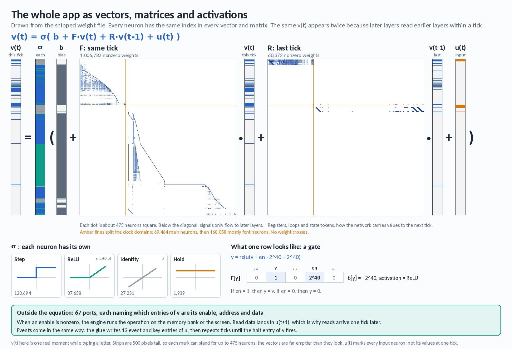</p>

*This figure is drawn from the shipped weight file. Each dot in a square is a group of real connections.*

#### The pieces

**A neuron is one number, plus a simple rule for updating it.** The app has 237,522 of them. One holds the caret's position, for example, and another is 1 only while a particular step of the program is running.

| Symbol | In plain words | Size |
|---|---|---|
| `v(t)` | The state vector: a list of every neuron's value at tick `t`. Almost all of them are 0 at any moment. | 237,522 numbers |
| `t` | The tick count. One tick is one update of the whole list. A key press takes roughly 65 to 150 ticks. | |
| `F` | The same-tick table. The entry at row `i`, column `j` says how strongly neuron `j` feeds neuron `i` within this tick. | 237,522 by 237,522, with 1,006,782 entries that are not 0 |
| `R` | The last-tick table. It works the same way, but reads neuron values from the previous tick. | The same size, with 60,372 entries that are not 0 |
| `b` | A fixed offset for each neuron, called its bias. | 237,522 numbers |
| `u(t)` | What arrives from outside this tick: an event from the glue, or data read from memory. | Mostly 0 |
| `σ` | Each neuron's activation: a simple rule applied to its total. | One rule per neuron |

The two tables are programmed, not learned. Each of their entries was written by the generator for a reason. Their entries that are not 0 fill less than 0.001 percent of each table, and they only ever use about 22,000 different values.

#### Reading it from the inside out

To update one neuron, do three things:

1. **Add up what it receives.** That is its bias, plus each input neuron's value times its weight, plus anything arriving from outside.
2. **Apply its rule.** Most neurons use one of the first two below.
3. **Store the result** as that neuron's new value.

| Rule | Output | Neurons | Used for |
|---|---|---:|---|
| Step | 1 if the total is above 0, otherwise 0 | 120,694 | Yes or no decisions |
| ReLU | The total if it is above 0, otherwise 0 | 87,658 | Passing a number through a gate |
| Identity | The total, unchanged | 27,231 | Adding numbers |
| Hold | Keeps its value, and adds any total to it | 1,939 | Registers that only remember |

The fourth rule is an engine detail. The generator writes three kinds of neuron, and the optimizer converts registers that do nothing but hold their value into this cheaper form.

#### Why `v(t)` is on both sides

This looks circular, but it is not. The neurons are numbered so that each one reads only from neurons before it, which puts every entry of `F` below the diagonal of the table. So the first neuron can be calculated from outside inputs alone. The second can then use the first, and so on to the end.

<p align="center"></p>

Here is that example written out, with an input of 5:

```
a = 5             a is 5
b = 10 × a        b is 50
c = a + b         c is 55
```

After the sweep, multiplying the table by the finished vector gives that same vector back. That is all the equation claims. It is like a spreadsheet, where a cell can use cells calculated before it, as long as no formula refers back to itself.

If you have seen numerical methods, this is forward substitution on a lower triangular system. Nothing is iterated, and there is no matrix to invert. Although the equation looks implicit, it is an explicit calculation.

#### How the two tables differ

- **`F` is for computing.** It carries signals within a tick, through as many as 152 layers in the main clock domain and 35 in the second. Most of a neuron's work happens here. A layer is just a group of neurons at the same depth, so layer sizes vary widely.
- **`R` is for remembering.** It carries values from one tick to the next. A register is a neuron that feeds itself through `R`, which is how the network holds a number over time. It is also how control moves from one program step to the next.

Together, they make a recurrent network. Each tick takes the last state and the new input, then produces the next state:

```
v(t) = G( v(t-1), u(t) )
```

Here `G` is the feed-forward network formed by `b`, `F` and `σ`. Each tick is one direct step forward, and the ticks do not converge toward an answer. They are the steps of a program, and they end when one particular neuron, the halt neuron, becomes nonzero.

#### A logic gate from one row

This shows how arithmetic becomes decisions. Say neuron `y` should pass a value `v` only when a control neuron `en` is 1. Give it these entries:

```
y = relu( v + en × 2^40 − 2^40 )
```

| `en` | Total | Output `y` |
|---:|---|---|
| 1 | `v + 2^40 − 2^40`, which is `v` | `v` |
| 0 | `v − 2^40`, which is far below 0 | 0 |

That is one row of `F`: a weight of 1 from `v`, a weight of 2^40 from `en`, a bias of −2^40, and a ReLU rule. With gates like this, the generator builds registers, comparisons, memory addressing and program flow.

#### What is not in the equation

The equation updates neurons and nothing else. Three things sit around it:

- **Memory and the screen.** The document is stored in a separate memory bank. There are ports that treat particular neurons as an enable, an address and data. When an enable is nonzero, the engine carries out that read or write. Data that is read comes back through `u` on the next tick.
- **The glue.** It writes events into `u`, runs ticks until the halt neuron fires, and shows the screen.
- **A second clock.** Neurons for drawing text and for managing styles run as a separate block with no connections to the main block, shown by the amber lines in the figure. A call port pauses the main block, passes values over, runs the second block to completion and passes the results back.

#### Layer by layer: the sizes

A layer here is a group of neurons at the same depth, so layers are not designed by hand, and their sizes vary widely. This figure shows every real layer of `F · v(t)`. It gives the number of neurons, the mix of activations, and how many weights feed that layer.

<p align="center">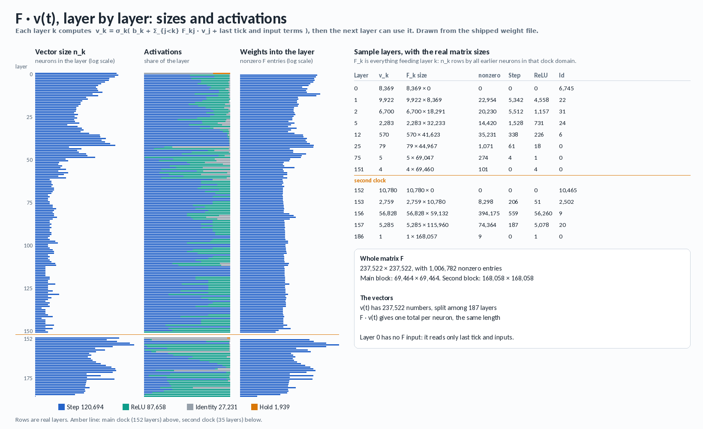</p>

`F_k` below is everything feeding layer `k`. It has `n_k` rows and one column for every earlier neuron in that clock domain. These are real values from the weight file:

| Layer | Neurons `n_k` | Size of `F_k` | Nonzero weights | Mostly |
|---:|---:|---|---:|---|
| 0 | 8,369 | none | 0 | Identity |
| 1 | 9,922 | 9,922 × 8,369 | 22,954 | Step and ReLU |
| 12 | 570 | 570 × 41,623 | 35,231 | Step |
| 75 | 5 | 5 × 69,047 | 274 | Step |
| 151 | 4 | 4 × 69,460 | 101 | ReLU |
| 156 (second clock) | 56,828 | 56,828 × 59,132 | 394,175 | ReLU |

Layer 0 has no `F` inputs at all: it reads only the last tick and outside input. The long run of very small layers in the middle is mostly step neurons making chains of decisions. Layer 156 is the largest layer, and it is nearly all ReLU. Its size is close to the number of outline edges the build reports, so it appears to hold the font edge neurons.

#### Real neurons, and where they live

This animation visits ten sub-networks. On the left, amber marks where that unit's incoming weights sit in the full matrices. On the right is a real neuron from the weight file, with its bias, activation and each weight coming in.

<p align="center">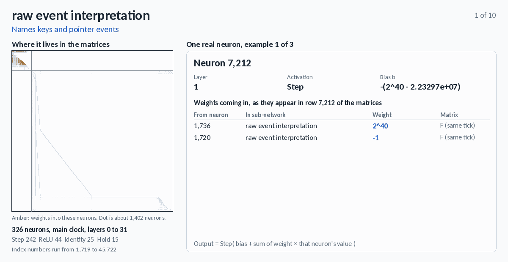</p>

Look for weights of `2^40` paired with a bias near `-2^40`: that is the gate described above. The font neurons also carry fractional weights, which fit the line coefficients of an outline edge. The examples were chosen to be easy to read, with 2 to 6 inputs each, so they are not a random sample. A sub-network's label can also look unexpected on an input, partly because merged neurons are credited to just one sub-network.

#### What the weights and biases look like

Trained networks usually have weights that look like continuous noise. These do not, because each value was chosen for a logical reason. This shows every real weight and every nonzero bias, by family of sub-networks.

<p align="center">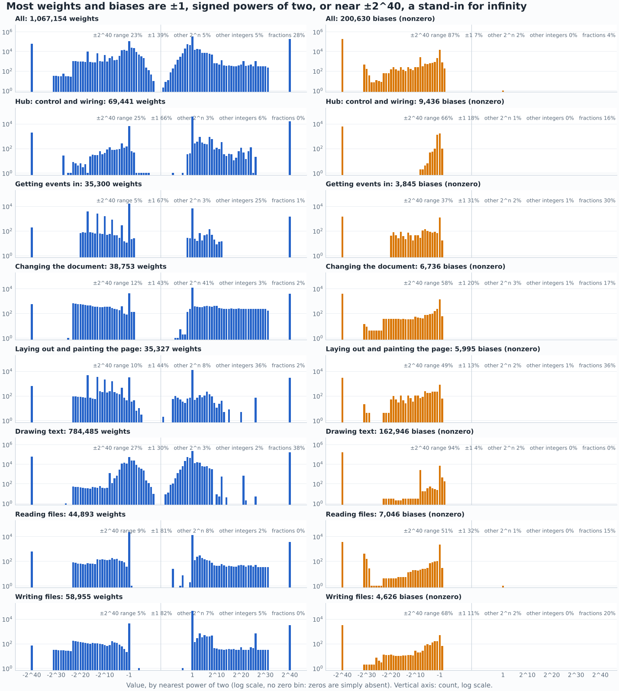</p>

The 1,067,154 weights use only 21,895 distinct values. They fall into a few groups:

| Kind of weight | Share | What it does |
|---|---:|---|
| ±1 | 39% | Passes or subtracts a signal, such as in AND and OR logic and in sums |
| Near ±2^40 | 35% | Works as infinity: a gate input that overrides anything else the neuron receives |
| Other powers of two | 2% | Reads or builds binary numbers, one bit per neuron |
| Other integers | 3% | Includes values such as `-100000`, which fit the digit thresholds used to write decimal numbers |
| Fractions | 21% | Almost all in text drawing, where they hold font geometry |

**The ±2^40 values are a practical stand-in for infinity.** Real values in the app stay far smaller, so an enable of 2^40 cancelling a bias near -2^40 is effectively a switch. It is not true infinity, and it has to be a finite number so that the arithmetic stays exact. Of the 245,003 weights near that size, all but 74 are exactly ±2^40.

**Biases are nearly always negative.** About 95% of nonzero biases are near -2^40, because they belong to gates. Only about 2% of those are exactly -2^40. Most carry a small offset, as in `-(2^40 + 256)`, which combines the gate with a small constant or threshold. The common fractional biases such as `-0.5` are thresholds for step neurons.

**The families have different shapes.** "Changing the document" has an even spread of powers of two from 2^1 to about 2^30, a sign of binary packing and unpacking. "Drawing text" is the only family with a wide smooth spread, and it comes from font coordinates and slopes. "Writing files" is about 90% ±1.

### From neurons to logic

The generator writes three activation functions. (The engine has a fourth kind internally, an optimization for registers whose only job is holding their value.) The important building block is the gate, which lets a one-bit signal decide whether a value passes.

<p align="center"></p>

This is the actual generator code from [`gen/nn.py`](gen/nn.py), with spacing and a comment added. It is ordinary weight arithmetic:

```python
def gate(s, val, en):
    val = as_x(val); en = as_x(en)
    if val.is_const(): return en * val.c
    return s.relu(val + en*M - M)      # M = 2**40
```

With gates you can build multiplexers, registers (a neuron feeding itself through a recurrent edge), comparators, decision trees and memory addressing. Linear expressions fold into the next real neuron at build time, so `a + 2*b` costs no neuron of its own.

### Control flow: a token in the weights

The program counter is a one-hot vector. In each clock domain, exactly one state neuron holds 1, and its weights open the gates for that step. Many neurons can compute in the same tick, but control moves one step at a time, much like a processor.

<p align="center"></p>

Subroutines work too: a return register holds the id of the state to go back to, and a small dispatch layer decodes it. The build fails if two states share a name.

### Why half a million neurons can feel instant

Neurons rest at zero, and the engine only visits a neuron when something nonzero reaches it. Gated neurons are lazy: their value inputs are read only if the gate opens. This is real data from the shipped weights, one frame per group of ticks. Watch the font outlines tile in the top left: it lights up only for a letter that has not been drawn before.

<p align="center">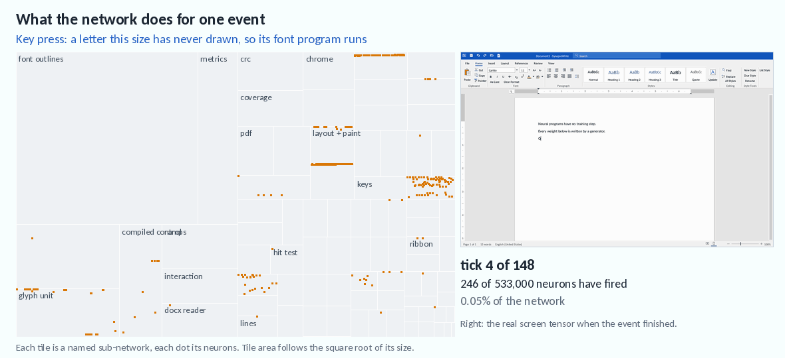</p>

<p align="center">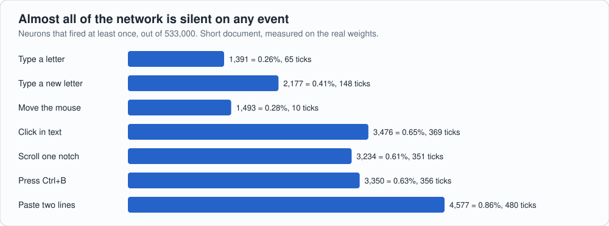</p>

| Event | Ticks | Edges pushed | Neurons fired |
|---|---:|---:|---:|
| Type a letter | 65 | 2,464 | 1,391 |
| Type a new letter | 148 | 112,745 | 2,015 |
| Move the mouse | 10 | 35,574 | 1,446 |
| Click in text | 369 | 159,525 | 3,485 |
| Scroll one notch | 2,873 | 158,932 | 7.3 M |
| Press Ctrl+B | 356 | 156,966 | 3,354 |
| Paste two lines | 480 | 271,004 | 3,831 |

Figures are from a short document at commit `46eef8b`. A long document costs more on events that repaint the whole view.

### Memory: the network holds the pointers

External memory is a passive tensor. The network produces every address, read, write, length and mask. The engine executes those signals and decides nothing.

<p align="center">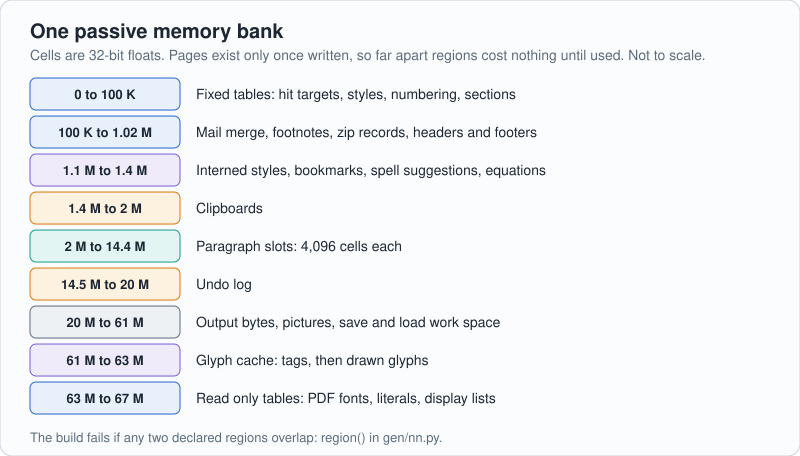</p>

Two timing rules shape the design: a read's data arrives on the tick after its address, and it lasts one tick. Much of the generator is careful scheduling around those two facts, much like programming a pipelined processor by hand.

### The screen is also an input

The output is RGBA, and the alpha channel is not transparency. It holds an object id. To answer "what did the user click?", the network reads the pixel under the pointer from its own last screenshot.

<p align="center">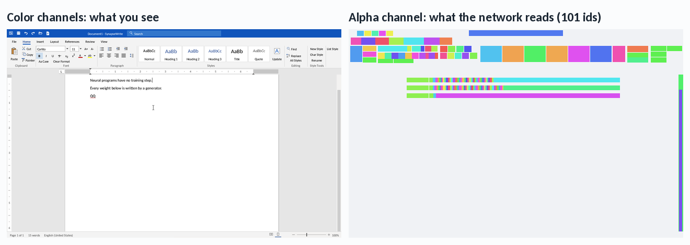</p>

So buttons, tabs and menu rows need no table of rectangles: they paint their ids as they draw. For a click in text, the id finds the line, and a line table in memory gives the exact document position. The pointer shape comes from the same plane. On caret blink ticks, a small checker also reads the screen back and compares it to the line table, then repairs any damage it finds.

### How a letter gets drawn

There is no stored bitmap font, and no transform basis. Open font outlines are compiled straight into weights. Each monotone chain of outline edges is one neuron whose weights are the chain's start, its first slope and the slope change at each vertex. A glyph is literally a small program made of neurons.

<p align="center">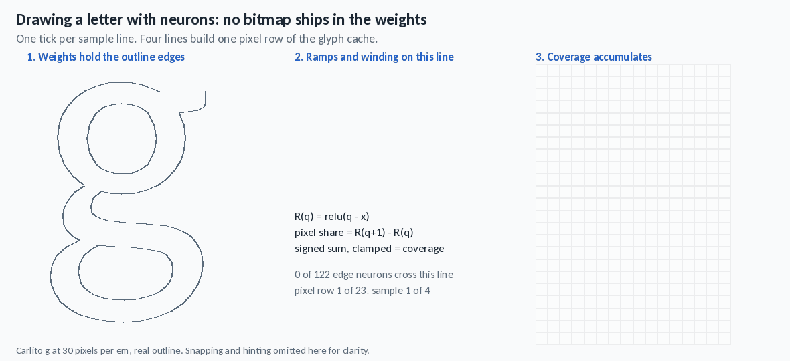</p>

1. A binary tree over the glyph's outline heights selects the edges that cross the current sample line.
2. Each chain neuron computes `x = X0*s + m0*(y - Y0) + sum of (m_k - m_(k-1))*relu(y - Y_k)` over its inner vertices, where `s` scales for the font size. One threshold per chain end decides when it is live, and the ramps `relu(y - Y_k)` are shared by every glyph of the face.
3. A shared bank of ramps, `R_q = relu(q - x)`, turns a crossing into pixel shares: `R_(q+1) - R_q`.
4. The signed sum is the winding number. A clamp makes it coverage.
5. Four sample lines accumulate into one pixel row.

The glyph unit runs in its own clock domain, entered through a call port while painting stalls. The style interner is the only other sub-network that works this way. Finished glyphs go to a cache in memory, tagged by face, size and character, so repeated letters skip the generator. That is why the font outlines tile stays dark for the second Q in the animation above. A small glyph drawn black on white is also recorded as pixels, so most later draws take one read and one patch.

Vertical snapping is a piecewise linear layer written from font metrics. Horizontal snapping is also written, but no font turns it on, because it looked worse when compared side by side. Eight open families ship: Carlito, Caladea, Arimo, Tinos, Cousine, Open Sans, Oswald and Caveat.

<p align="center">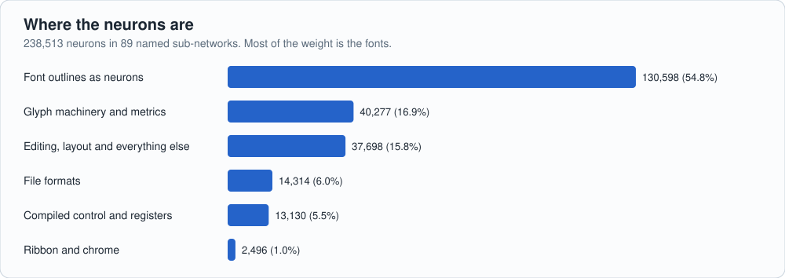</p>

The other 107,000 or so neurons hold the rest of text drawing and the entire word processor. The provenance record, [`PROVENANCE.md`](PROVENANCE.md), lists all 93 sub-networks with their purposes and generator files, and is regenerated by every build.

### File formats are networks too

Opening a `.docx` means inflating a zip file and parsing XML. Saving means writing XML, compressing it with deflate, computing CRC32 and assembling a zip. All of that is neurons.

<p align="center"></p>

The same is true of PNG pictures and PDF export. The network also chooses the file name and tells the glue when to offer the download.

## How it is put together

What connects to what, what every part does, and what sits outside the network.

### How everything is connected

The whole app is one neural network: one graph of neurons, evaluated by one engine. A "sub-network" is a label on a set of those neurons, recorded by the generator so each neuron can be traced to its purpose. There is no boundary in the weights between them. The colored families in this figure are just categories for this README. The sub-networks are also not wired in a chain: they are built around a hub. This figure and the numbers below are decoded from the shipped weight file, and the engine ports are read from the same file.

<p align="center"></p>

**The hub is where features meet.** The largest piece, `compiled control`, is where the generator compiles every state rule. If twenty features can write the caret, then the caret register has one sum here, with a gated term from each. So features rarely call each other. They set shared registers and drive shared ports, and a closed gate contributes exactly zero.

| Between | Connections |
|---|---:|
| Hub (control and wiring) and Writing files | 24,849 |
| Hub (control and wiring) and Reading files | 14,618 |
| Changing the document and Hub (control and wiring) | 14,097 |
| Hub (control and wiring) and Laying out and painting the page | 13,966 |
| Getting events in and Hub (control and wiring) | 6,353 |
| Drawing text and Laying out and painting the page | 3,815 |
| Changing the document and Drawing text | 2,565 |
| Changing the document and Writing files | 2,211 |
| Laying out and painting the page and Writing files | 1,652 |
| Changing the document and Getting events in | 1,239 |

Each row is the connection count between two families. These are the ten largest of 21 pairs.

**The glue sits only at the edges.** It connects to the network through the pieces below, and nowhere else.

| Glue piece | What crosses it | Network side, as measured |
|---|---|---|
| Event encoder | Event kind, 3 arguments, modifiers, day number | Input neurons in `bank and port wiring` |
| Key encoder | Code units of the key name, and its length | Input neurons in `bank and port wiring`, read by `raw event interpretation` |
| Byte encoders | File bytes, paste text and phone field text, written straight into the bank | `docx reader`, `png reader`, `paste` and `raw event interpretation` then read them |
| Tick loop | Calls the engine until the halt neuron fires | Halt neuron in `bank and port wiring` |
| Display | Copies changed rows of the screen tensor to the canvas | Screen ports driven by `bank and port wiring`, `glyph unit` and `pointer` |
| Timer | Sets a browser timer for the requested time | Timer neuron in `bank and port wiring` |
| Clipboard out | Sends a text the network placed in the bank | Length neuron in `bank and port wiring`, hold in `raw event interpretation` |
| Clipboard in | Asks the browser for text | Request neuron in `range walker` |
| Save file | Reads bytes and a name from the bank, and offers a download | `file output command` |
| File pickers | Opens a picker for a document or a picture | Request neurons in `docx reader` and `png reader` |
| Browser defaults | Lets a key do its normal action, or holds mouse moves for a frame | `raw event interpretation` |
| Keyboard field | Sets field text and focus, for phones | `raw event interpretation` |
| Added words | Copies the added word list to browser storage | Length neuron in `docx reader rv_a5` |

**The engine ports are the network's only way to act.** There are 24 memory read ports, 26 memory write ports, 5 rectangle ports, 4 patch ports, 3 copy ports, 1 screen pixel read port, 2 style read ports and 2 call ports. The two call ports enter the glyph unit and the style interner, which each run in a second clock domain while the main one stops.

Here is every connection, at the level of single sub-networks. Each row sends to each column.

<p align="center">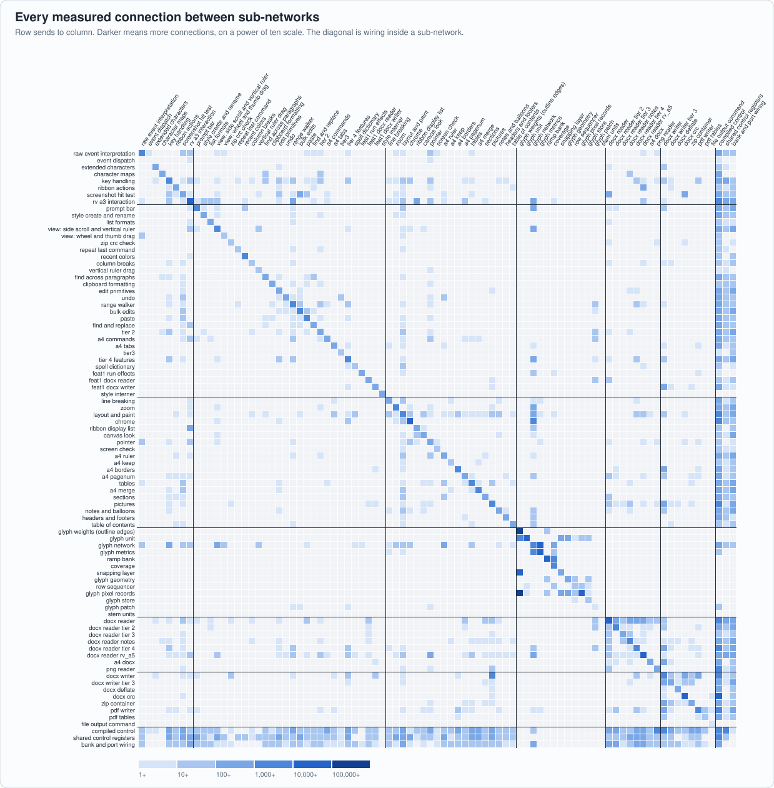</p>

Two things to keep in mind when reading it. The build merges duplicate neurons, and a merged neuron is credited to just one sub-network. So a line between two unrelated names, such as `png reader` and `compiled control`, can be logic they share. That is also why a few reader and writer names light up slightly on a key press. The raw data is in [`docs/figures/src/connections.json`](docs/figures/src/connections.json).

<!-- networks:start -->
### Every sub-network, and why it exists

The build traces each neuron to one of 93 named sub-networks. This is the whole list, with neuron counts from the current build. Names are the exact labels in [`PROVENANCE.md`](PROVENANCE.md), and some keep working labels from when they were written (`a4`, `rv a3`, `tier 2`).

<p align="center"></p>

#### Getting events in (15,943 neurons)

The browser reports raw facts, such as a key name or a button mask. Deciding what those facts mean is application logic, so it has to happen in neurons.

| Sub-network | Neurons | What it does | Why it exists |
|---|---:|---|---|
| `compiled control` | 9,468 | Holds every state rule, compiled together: the gated sums that give each register its next value, plus the return dispatchers. | This is where features actually meet. A register written by many features has one sum here, with one gated term per rule that writes it. |
| `rv a3 interaction` | 2,901 | Handles word and page motion, right click, autoscroll while dragging and the context menu. It also holds the later tier 1 features from `gen/t1_features.py`. | These editing motions need more than a single key rule, because they scan text and follow the pointer over many ticks. |
| `bank and port wiring` | 1,302 | Holds the shared wires that drive the memory, image and event ports, including the input neurons the glue writes into. | Ports are the only way out of the network. Several sub-networks use each port, so one place sums their addresses and enables. That avoids a duplicate port per feature. |
| `key handling` | 607 | Maps each key and modifier combination to an editing command. | Shortcuts are behavior, so they live in weights instead of a key table in the glue. |
| `shared control registers` | 573 | Holds editor state such as caret, selection and typing format, plus the comparators that order a selection. | Many features read the same state. Shared registers mean each feature does not keep its own copy that could fall out of step. |
| `screenshot hit test` | 382 | Reads the object id under the pointer from the last screen. For text, it then uses the line table in memory to find the document position. | The screen already knows which object was drawn where, so buttons and menus need no separate table of rectangles. |
| `raw event interpretation` | 329 | Turns key name code units, button masks, pointer types, field text and touch positions into cooked events. It also tells the browser whether its default action stands. | The glue is forbidden from knowing what Enter or a right click is. This network is what makes that rule possible. |
| `ribbon actions` | 155 | Maps a clicked button id to its command. | The ribbon has many targets. One map lets the pointer path stay the same for all of them. |
| `extended characters` | 131 | Writes and reads UTF-8 for characters past Latin-1, joining and splitting surrogate pairs. | Cells keep browser code units, so paste and copy stay one to one. Only the file format needs bytes. |
| `character maps` | 94 | Converts between Unicode and the internal character codes, using the Windows-1252 block. | Keeping internal codes small keeps glyph, metric and spelling tables small. Files and the clipboard still need Unicode. |
| `event dispatch` | 1 | One neuron left from the first dispatcher. It did not fire on the key presses we traced. | Routing now lives in `raw event interpretation` and the state rules. It is listed so that the record stays complete. |

#### Changing the document (9,197 neurons)

These networks are the only ones that write document text. They all go through the same edit and undo paths, so everything stays undoable.

| Sub-network | Neurons | What it does | Why it exists |
|---|---:|---|---|
| `feat2 built up math` | 1,792 | Builds, measures, paints, saves and prints the newer equation forms: a root with an index, sums, products and integrals with limits, five accents, delimiters as tall as their line, and a two row matrix. Reads them back from OMML as their linear form. | Each form is one character standing for a record, as fractions and roots already were, so editing, undo and layout carry them with no new path. A delimiter is its own record, so what stands between two of them can itself be built up. |
| `tier 4 features` | 705 | Implements tracked changes, fields, equations and mail merge. | These change what a run of text means, rather than how it looks. |
| `bulk edits` | 662 | Processes windows of many cells per tick for large formatting, copy, save, paste and find operations. | Going one cell per tick is too slow on a 100 page document. These walkers keep large operations usable. |
| `view: side scroll and vertical ruler` | 557 | Slides a page wider than the window, draws the bar along the foot, moves the slide to follow the caret, and draws the vertical ruler. | Above 150 percent a page no longer fits the window. The zoom map stays linear, with one more shift, so hit tests and paint still agree. |
| `prompt bar` | 524 | One bar that takes a short text and hands it to the command that asked: a color, a new style name, a new name for a style, or a font name. | These commands each need one line of text. One bar with one buffer does all of them, so no command has its own field. |
| `range walker` | 479 | Walks a selection for copy, cut, delete and formatting. | Selections cross paragraphs and slots. One walker holds that hard logic, and each command just supplies the action. |
| `tier 2` | 391 | Implements style commands, paragraph commands, lists and typed font sizes. | These commands share paragraph records and a style table, so they are grouped around that data. |
| `a4 commands` | 344 | Implements repeat, format painter and keep rules, among others. | These are small commands that reuse existing registers, and each needs only a few rules. |
| `feat2 pdf run effects` | 307 | Prints character spacing as text spacing, run shading under the text, double strike as two lines, and external links as link annotations of the page. | These properties already live in the style entry and on screen; a printed page should show what the screen shows, and a link should still work. |
| `find and replace` | 279 | Runs a search automaton over the document, counts matches and replaces them. | Search needs its own scanning state, which is separate from the caret. |
| `feat1 docx reader` | 279 | Reads caps, small caps, double strike, hidden text, character spacing, run shading, links and their targets, bookmarks, contextual spacing and widow control. | Each lands in a field of the interned style entry or a paragraph cell, so edits, undo and the clipboard carry it with no new path. |
| `recent colors` | 276 | Keeps the last eight exact text colors, newest first and without repeats, draws them in a row of the text color menu, and sends a clicked one back through the More Colors path. | A color picked from the grid or typed as hex is hard to find again. The list reuses the exact color path, so undo, save and the nearest palette entry come with it. |
| `p3 matrix` | 270 | Builds, measures, draws, prints and saves matrices of any number of rows, each column as wide as its widest cell and each cell centred in it. | A matrix reads by its columns; cells of different widths should still line up, and a matrix is not limited to two rows. |
| `feat1 docx writer` | 243 | Writes those properties back, opens and closes links and bookmarks around runs, and lists external link targets as relationships. | A file that is opened and saved should keep what it had, even where the editor has no command for it yet. |
| `find across paragraphs` | 233 | One matcher for queries that hold paragraph marks, shared by the replace walker, the match counter and the highlight. | A match that crosses a paragraph cannot be found inside one slot, so it needs state that follows the text across slots. |
| `paste` | 208 | Inserts clipboard text and splits it into paragraphs. | Pasted text arrives as a flat vector of code units, and the document stores paragraphs. |
| `edit primitives` | 196 | Inserts and deletes characters and paragraphs, and logs each change for undo. | It is the single choke point for edits, so undo cannot be bypassed by accident. |
| `style create and rename` | 177 | Writes a new style table entry from the format at the caret, renames a style with undo records, and applies a character style over a run. | Files and users both name styles. Keeping these in the style table means save, open and apply work for them with no new paths. |
| `a4 tabs` | 160 | Handles tab stops. | A tab has no fixed width. Its advance depends on the current position, so layout needs a dedicated rule. |
| `p3 docx properties` | 154 | Reads emboss, imprint, outline, shadow, character scale and language of a run, and the outline level of a paragraph, into the fields a style entry already has room for. | Word files carry these on many runs; a file opened and saved here should come back with them. |
| `list formats` | 151 | Gives the list format menu, and reads numFmt and lvlText per level from a file. | A list format is a small number kept in the paragraph record. Splits, undo and clipboard then carry it with no extra work. |
| `style interner` | 151 | Finds or adds a style record in the interned table, in its own clock domain. | Each character stores a short index instead of a full record. That makes the text compact and makes comparing two styles a single check. |
| `p3 pdf destinations` | 143 | Gives each printed bookmark a named destination in the PDF and, unless its name is hidden, an outline item; links to a place in the document become link annotations that go to that destination. | A bookmark and an internal link should still take the reader to the same place in the PDF as in the document. |
| `undo` | 111 | Walks the log backward and forward to undo and redo. | The log format is shared, so any feature that logs correctly gets undo with no extra network. |
| `clipboard formatting` | 103 | Keeps the style cells and paragraph records of the copy, and restores them when the pasted text equals that copy. | The system clipboard carries only text here. So the network keeps formatting in its own memory, and uses it when the pasted text matches. |
| `p3 docx writer` | 72 | Writes those run and paragraph properties back in schema order, the language as the attribute text it was read with. | What was read must be written again for a round trip to keep the file. |
| `spell dictionary` | 67 | Walks a word automaton held as a read only table, with one read per painted letter, and marks misspelled words. | An automaton checks a word at one step per letter. The table is built from the word list by merging identical subtrees, with no fitting. |
| `feat1 run effects` | 49 | Decodes the extended field of a style entry for the glyph network: caps and small caps draw the capital, small capitals take a smaller size, hidden text takes no width or ink, and character spacing joins the advance. | These properties change what is drawn and how wide it is, so the glyph network must see them. One neuron answers for the usual character that has none of them. |
| `view: wheel and thumb drag` | 22 | Turns Shift+wheel and a sideways wheel delta into a slide of a wide page, and lets the thumb of the bar at the foot be dragged, at the scale that draws it. | The glue only reports raw deltas and modifier bits. Deciding that Shift means sideways, and mapping pointer travel to page travel, is application logic, so it lives in neurons that feed the existing slide path. |
| `column breaks` | 22 | Ctrl+Shift+Enter splits the paragraph and marks the new one with a column break, with undo; reads and writes the break as w:br of type column. | A column break is the page break flag with a second value, so layout, undo and save reuse the page break paths. Layout only needs one more rule: in the first of two columns the paragraph moves to the second. |
| `tier3` | 22 | Holds the remaining tier 3 commands, plus undo for their operations. | It connects tier 3 features to the shared undo log. |
| `repeat last command` | 21 | Remembers which kind of formatting command ran last; F4 enters that command again, whose registers still hold the last values. | Word users repeat a format onto the next selection with F4. The commands already keep their arguments in registers, so repeat needs only a kind register and one dispatch state. |
| `zip crc check` | 18 | After the dry inflate of the main part, runs its bytes through the save CRC network and compares with the CRC in the central directory; a mismatch refuses the file and keeps the document. | A corruption that still inflates to the stated size would otherwise open with wrong text. The CRC network already exists for save, so the check costs only three states and two registers. |
| `vertical ruler drag` | 9 | A press near the top or bottom margin edge on the vertical ruler starts a drag; the release sets that margin of the caret section, snapped to a sixteenth of an inch, unzoomed, with undo. | The vertical ruler only showed margins. Dragging them reuses the horizontal ruler release path and the section edit, so undo and relayout come with it. |

#### Laying out and painting the page (7,901 neurons)

These networks decide where everything goes, then draw it.

| Sub-network | Neurons | What it does | Why it exists |
|---|---:|---|---|
| `chrome` | 1,661 | Draws the caret, scrollbar and status bar, and handles autoscroll. | These change on most events and must update without repainting the page. |
| `layout and paint` | 1,227 | Walks paragraphs and places lines and words. It draws text, selection and pictures. | It is the main drawing loop. Most features add to this one walk, so they do not repaint separately. |
| `pictures` | 926 | Draws picture handles, resizes pictures by resampling, writes PNG and reads pictures from a file. | A picture is the one document object that is not text, so it has its own storage and drawing path. |
| `a4 merge` | 639 | Handles merged table cells. | Merging breaks the simple grid that the table walker assumes, so it needs its own rules. |
| `tables` | 637 | Scans tables, inserts them, edits rows and columns, applies shading, and handles border hit zones and dragging. | A table has structure that must stay consistent as rows and columns change, and borders are also click targets. |
| `zoom` | 457 | Handles zoom levels from 50 to 150 percent and read mode, maps paint to the screen at the chosen scale, and runs the status bar controls. | Paint works in page coordinates. This keeps the many drawing paths unaware of the zoom level. |
| `a4 borders` | 387 | Draws paragraph borders and shading, on screen and in PDF. | Neighboring paragraphs can join borders, so this cannot be drawn one paragraph at a time. |
| `a4 ruler` | 330 | Draws the ruler and handles dragging its markers. | The ruler both displays and edits paragraph properties, so it needs its own drawing and pointer logic. |
| `line breaking` | 299 | Finds where lines break, and handles alignment. | Every paragraph needs it, and it runs on each edit, so it has to be small. |
| `notes and balloons` | 257 | Draws wrapped text, comment balloons and footnotes. | These flow outside the normal text column, and they take space from the page or margin. |
| `a4 pagenum` | 254 | Handles page number formats and section start values. | Page numbers depend on sections, and they have to come out the same on screen and in a PDF. |
| `table of contents` | 175 | Builds and updates the table of contents. | It has to scan headings and their final page numbers, which are known only after layout. |
| `ribbon display list` | 150 | One sequencer that plays draw records for the ribbon, menus and labels from read only memory, one item per tick. | Drawing a ribbon is data more than logic. Its neurons are shared by every list, and the lists themselves cost no neurons. |
| `pointer` | 118 | Draws the mouse pointer, saves and restores the colors under it, and chooses its shape from the screen. | The output is one image, with no system cursor over it. So the network has to draw the pointer and clean up after it. |
| `sections` | 112 | Holds section records, section breaks and page setup. | Page size, margins and columns can change partway through a document. |
| `headers and footers` | 112 | Holds header and footer strings and their edit bar. | They repeat on each page, and they are edited separately from the main text. |
| `canvas look` | 82 | Draws the page shadow and the canvas around the page. | This is the appearance around the page, kept separate because it does not depend on the document. |
| `a4 keep` | 55 | Applies keep with next and keep lines during pagination. | It has to add up the height a paragraph must share a page with before placing its first line. |
| `screen check` | 23 | Compares one line of the id plane with the line table on each blink tick, and repairs it by repainting. | The project requires checking the screen against document state. This catches drawing damage as the app runs. |

#### Drawing text (189,831 neurons)

This is the largest family. It is what replaces a font engine. The method is described in [How a letter gets drawn](#how-a-letter-gets-drawn).

| Sub-network | Neurons | What it does | Why it exists |
|---|---:|---|---|
| `glyph weights (outline edges)` | 130,598 | Holds the font outlines as edge neurons, one small program per glyph. | This is the font itself, written as weights. It accounts for most of the neurons, since eight families with their faces hold many edges. |
| `glyph metrics` | 20,677 | Holds advance widths and kerning as decision trees. | Layout needs widths for each character, and it should not have to draw a glyph to learn one. |
| `glyph pixel records` | 19,104 | Records a small glyph drawn black on white, so that later draws take one read and one patch. | Most repaint cost was glyph rows. Replaying a record is much cheaper for the common case of plain text. |
| `glyph unit` | 10,799 | Runs the drawing of one glyph, in its own clock domain. | Paint can stall while a glyph is generated, and that keeps the paint loop simple. |
| `ramp bank` | 5,475 | Provides shared ramps, `R_q = relu(q - x)`, that turn a crossing into pixel shares. | Ramps are the same for all glyphs, so one bank serves every edge. Each glyph does not need its own. |
| `coverage` | 1,931 | Adds edge shares into pixel coverage, and once per row adds the share of whole blocks of columns from one delta per crossing. | It turns signed crossings into how much of a pixel is ink, which gives smooth edges. |
| `glyph network` | 616 | Selects and addresses a character cell for drawing. | It is the junction between layout and drawing, whichever way the glyph is produced. |
| `snapping layer` | 338 | Fits outline heights to the pixel grid for a given size. | Unsnapped text looks blurry at small sizes, so heights move to whole pixels using font metrics. Horizontal snapping is written, but no font uses it now, because it looked worse side by side. |
| `glyph geometry` | 235 | Scales outline coordinates by the drawn size. | A single set of weights can then serve any size, rather than storing outlines per size. |
| `row sequencer` | 29 | Steps the glyph unit through the rows of a character. | Coverage builds one sample line per tick, so something has to count them. |
| `glyph store` | 17 | Keeps drawn glyphs in memory and copies them to the screen. | Generating a glyph costs far more than copying one, and most letters repeat. |
| `glyph patch` | 12 | Assembles coverage and color into a patch for the patch port. | Text color is applied here, so a cached glyph works in any color. |
| `stem units` | 0 | Would hold stem positions for horizontal snapping. It has no neurons in the current build, because no font turns that on. | It is listed so that the provenance record stays complete. |

#### Reading files (8,571 neurons)

Each of these exists because no parser library is allowed. XML, zip and PNG bytes are consumed one state at a time.

| Sub-network | Neurons | What it does | Why it exists |
|---|---:|---|---|
| `docx reader` | 2,939 | Unzips the file, inflates it and parses the document XML. | It is the core of opening a file. The goal requires that networks do parsing and decompression. |
| `docx reader tier 4` | 1,724 | Reads tracked marks and fields. | These wrap ordinary runs in extra elements, so they add state to the parser. |
| `docx reader rv_a5` | 1,503 | Improves fidelity on files from other programs: nested tables, row spans, spacing and truncated content. It also holds spell suggestions and the saved list of added words. | Real files use forms that a simple reader misses. The spelling parts sit here only because of where they were added in the generator. |
| `docx reader notes` | 819 | Reads footnote, comment and header parts. | Each of these has its own XML part that must be connected back to the main text. |
| `docx reader tier 2` | 816 | Reads styles, numbering, and run and paragraph properties. | Formatting in `.docx` is scattered across several parts and elements. |
| `png reader` | 372 | Decodes PNG files to pixel words, with limits on bad input. | Pictures in a `.docx` are usually PNG, and they have to become pixels the network can draw. |
| `a4 docx` | 271 | Reads and writes the paragraph properties added by the commands above. | Anything the app can do must survive a save and open, so features carry their own file code. |
| `docx reader tier 3` | 127 | Adds walking between the parts of a file. | Tier 3 content lives in separate parts of the zip file. |

#### Writing files (6,079 neurons)

Saving runs the same idea in reverse. The network produces every byte, and the glue only offers the download.

| Sub-network | Neurons | What it does | Why it exists |
|---|---:|---|---|
| `docx crc` | 2,711 | Computes CRC32 of the bytes written to the zip file. | Zip readers reject a file with a wrong checksum. It holds four 256 entry tables as weights, so it can process four bytes at once. |
| `pdf writer` | 1,455 | Writes PDF objects, text and pictures. | Print to PDF is in the goal, and PDF has its own structure of objects and offsets. |
| `docx writer` | 1,095 | Writes the document XML parts. | A saved file needs XML text with the values of this document filled in. |
| `docx writer tier 3` | 306 | Writes section properties, tabs, markers, comments, notes, headers and footers. | These features add elements and whole parts to the saved file. |
| `docx deflate` | 242 | Compresses with LZ77 and fixed Huffman codes. | `.docx` files are compressed zip files, and compression has to happen in the network too. |
| `zip container` | 210 | Keeps the member table, and writes the central directory and table XML. | The directory at the end of a zip file has to list the size and offset of each part. |
| `pdf tables` | 55 | Writes PDF page size, table rules and shading. | Table lines are drawn as PDF commands, not as characters. |
| `file output command` | 5 | Selects the length, data start and file name that the glue saves. | The glue must not decide what to save, or under what name. It reads these neurons and acts. |

<!-- networks:end -->

### What is not the network

<p align="center">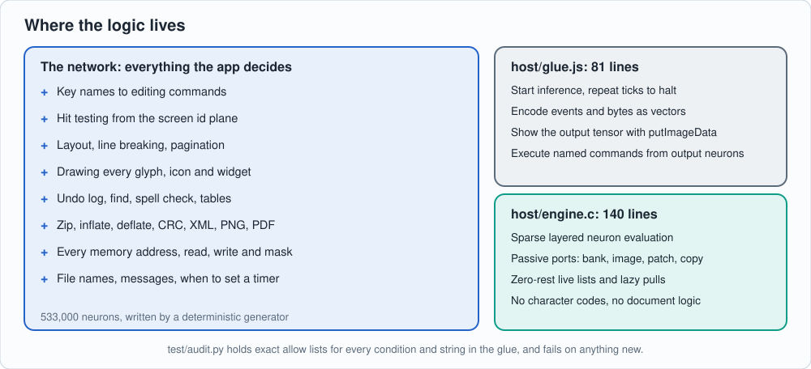</p>

The rule is that glue may not branch on, parse, format or interpret application data. It is enforced, not just promised. [`test/audit.py`](test/audit.py) holds an exact allow list of every `if` condition and string literal in the glue, and bans text parsing calls and drawing APIs. Anything new has to be argued for in that file.

Three things run outside the network, and they are all plumbing: the WASM inference engine, the event and byte encoding, and the commands the network raises by name (save this file, set this timer, focus this field). The glue also keeps the spell checker's added words in browser storage when the network says to.

### How it is built

<p align="center"></p>

Weights compress well because they recur. Neurons are stored in layer order as small integer deltas, weights index a table of distinct values, duplicate neurons are merged, and dead ones are removed. Display lists hold the ribbon, menus and labels in read only memory, played by one sequencer. The page also carries read only tables for strings, the spell automaton and PDF fonts.

## What kind of thing is this?

What the network can fairly be called, and how it behaves.

### Is it a circuit?

Largely, yes. The generator works more like a hardware compiler than a machine learning tool. Every neuron acts as a circuit part, and a matrix row is that part's wiring. All of the network has this structure. But only part of it is digital logic, and some of the system is not a circuit at all.

| Circuit | This network |
|---|---|
| Netlist, listing what connects to what | `F` and `R`, with weights as the connections |
| Combinational logic | One sweep through `F` |
| Gate depth | Number of layers: up to 152 in the main block |
| Flip-flops and registers | Values carried through `R` to the next tick |
| Clock cycle | One tick |
| Control unit | One-hot state neurons |

<p align="center">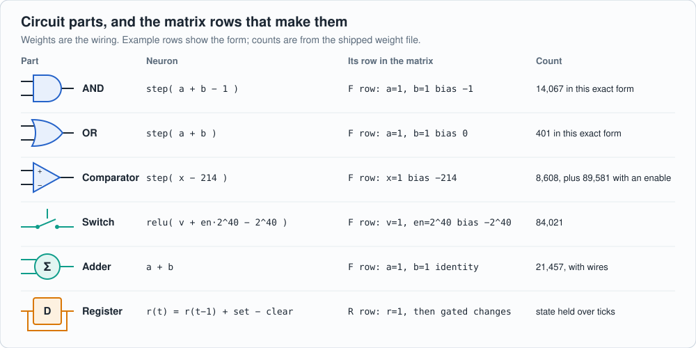</p>

The idea has a long history: McCulloch and Pitts described neurons as threshold logic in 1943. A matrix-vector product `F·v` here is a circuit's input totals. One sweep through the layers is the signals settling.

#### What behaves like what

I classified every neuron from its activation, bias and incoming weights:

<p align="center">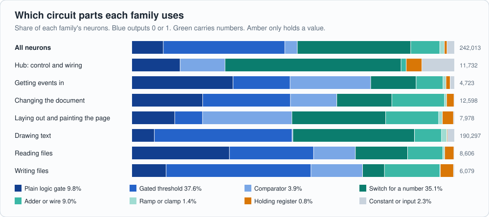</p>

| Behavior | Neurons | Where it matters most |
|---|---:|---|
| **Digital logic:** plain gates with weights of ±1 | 22,165 (9.3%) | Reading files, events, control |
| **Digital decisions from numbers:** comparators, and thresholds with an enable | 98,529 (41.5%) | Mostly `Drawing text`, plus layout and files |
| **Numbers switched on and off** | 84,268 (35.5%) | Mostly `Drawing text`, and also registers |
| **Number arithmetic:** adders, wires, ramps and clamps | 24,984 (10.5%) | Layout, and text coverage |
| **Holding values:** registers with no other work | 1,939 (0.8%) | Everywhere |
| **Constants and inputs** | 5,637 (2.4%) | Control, and text |

Only a small share is pure Boolean logic. Most of the network is mixed-signal in style: 0 or 1 signals control wires that carry whole numbers. The classification comes from the form of each neuron, so a few may do something else, such as a weighted step that is not really a comparison.

Actual values show the same mix. In a short session of typing, clicking, formatting and find, on the main clock block only, 3,833 neurons fired over 6,551 ticks. Of those, 2,336 (61%) only ever held 0 or 1, and 1,497 (39%) held other numbers.

#### Where the comparison holds, and where it does not

**It holds for the whole network's structure.** All of the neurons, including the fonts, are fixed parts wired together, clocked by ticks. No part is computing anything other than a weighted sum and a simple rule.

**It is only loose for number-carrying parts.** In digital hardware, a 32-bit value needs 32 wires, and addition needs an adder circuit. Here one neuron holds a whole number, and a sum takes one neuron. That is closer to an analog circuit, but it is not really analog, because the values are exact 64-bit floats with no noise. The font edges are the clearest case: the geometry is ordinary arithmetic, with gates selecting which edges are active.

**It does not apply to these:**

- **Multiplying two variables.** Weights are fixed, so a neuron can only multiply by a constant. Multiplying two changing values would have to be built from switches, as it is in a hardware multiplier.
- **Memory and the screen.** These are stored outside the network, in the engine. Hardware has RAM too, but here no gates implement it. The rectangle, patch and copy ports are also loops in the engine, not neurons, although the network controls them.
- **Timing.** A real circuit has wire delays, glitches and a clock limit. Here a sweep is simply calculated in order, so these issues do not arise.
- **The engine's shortcuts.** Skipping zeros and closed gates is a property of how this software simulates the circuit. It changes the speed, not the design.
- **The glue and the browser.** These are ordinary code around the circuit, limited as described in [What is not the network](#what-is-not-the-network).

**Clock domains have a hardware parallel.** Pausing the main block while the second one runs resembles clock gating. As a call that runs to completion, it is also like a software subroutine.

### How do we classify what this is?

The short answer is a **neural program, written at the generator level**: a fixed-function recurrent threshold-linear network whose weights implement a complete interactive application. Those weights are mostly the compiled output of a program that a language model wrote.

| Term | Does it fit? | Why |
|---|---|---|
| **Neural network** | Yes, by definition | It has weighted sums, activations, layers and recurrence. But it has no learning and no generalization, and one wrong weight breaks it like a bug in a program. |
| **Neural program** | Yes | The weights are the program. In much of the research, though, the phrase means a program a network learned, so it helps to say this one was written. |
| **Circuit** | Yes in structure | See [Is it a circuit?](#is-it-a-circuit). Most of it is mixed-signal in style, and only a small part is pure logic. |
| **Neural computer** | Partly | It has a program counter, registers, addressed memory and input and output. But the program is the wiring. It has no instruction set and cannot load other software, so it is a fixed-function machine, closer to a chip that only does one job than to a CPU. |
| **Weight-Space Programming** | Arguably, at the generator level | [The original post](https://rikiyat.github.io/blog/weight-space-programming/) describes a language model reading and writing weights directly. Here, a language model authored the design and the weights, but through a generator. It rarely read them. See below. |
| **Machine learning** | No | There is no data, loss, gradient or search. |

#### Is this Weight-Space Programming?

Reasonable people could answer either way. Here is the case on each side.

**For:** No independent person or formal program decided what the weights do. One language model, across several agents, designed the layers, wrote the primitives, wrote the generator and debugged the result, under a rule against training or search. A generator can be seen as a tool for setting values, since a network of 450,000 neurons could not practically be typed one value at a time.

**Against:** The original post lists compiling from formal programs as a separate approach. The primitives in `gen/nn.py` work much like a hardware description library, the optimizer changes neurons in ways nobody designed one by one, and the fonts are converted mechanically. The post's experiments also feature a model reading raw weights, which this project barely did.

This is how the work actually happened, based on the project's progress logs:

| Level of work | How often | Example |
|---|---|---|
| Generator source code | Nearly all design and debugging | Writing state rules with `on(...)` |
| Screens and saved files | All the time | Comparing images, and opening saved files |
| Neuron activity and counts | Often, for speed | Which neurons fired, linked to generator lines |
| Reasoning about the form of weights | Occasionally | A weight of 2^39 being treated as a gate enable, and a rule that prunes gates that cannot open |
| Reading single neurons from the file and interpreting them | Rarely, and only after the app was built | Neuron 366,977 looks like an outline edge |

Where the weights come from also varies:

- **Chosen for a reason:** thresholds and constants, from a specific design decision.
- **Set by a primitive:** `±2^40`, `±1` and most biases follow automatically when the generator calls `gate` or `and_`.
- **Taken from data:** nearly all the fractional weights come from font outlines.
- **Changed by the optimizer:** merging combines neurons with no one designing each result.

So this is strong on writing weights and weak on reading them. A fair summary is that the generator was the program, and the weights are mostly its compiled output. Reading a neuron here also relied on knowing the generator: an unfamiliar weight file would be much harder to interpret. The label "Weight-Space Programming at the generator level" is the closest this project claims.

#### Earlier work it relates to

| Line of work | Example | How weights are made | Relationship |
|---|---|---|---|
| Threshold logic | McCulloch and Pitts, 1943 | Designed logic | Its foundation |
| Neural compilers | [Siegelmann, 1994](https://mlanthology.org/aaai/1994/siegelmann1994aaai-neural): the NEL language to a recurrent network | Compiled | Closest earlier form of the result |
| | [Gruau, Ratajszczak and Wiber, 1995](https://gpbib.cs.ucl.ac.uk/gp-html/DBLP_journals_tcs_GruauRW95.html): Pascal to a network | Compiled | Closest earlier form of the result |
| | [Carreira et al., 1998](https://core.ac.uk/download/32330732.pdf): "Building a Neural Computer", recursive functions to a recurrent network | Compiled, no training described | Closest earlier form of the result |
| Compiled modern networks | [Tracr, Lindner et al., 2023](https://arxiv.org/abs/2301.05062v3): programs to transformers | Compiled, to give interpretability research a known ground truth | Similar method, different goal |
| Trained programs | Neural Turing Machines; [Neural Programmer-Interpreters](https://arxiv.org/abs/1511.06279v4) | Trained | Similar structure in places, opposite method |

#### What may be different here

These may be unusual, but they have not been checked against a full literature survey, so this project makes no claim to be first:

- **Scale of the target.** The earlier compilers above worked on functions and algorithms. This is a whole application, with a graphical interface, text rendering, file formats and compression.
- **The screen as an input.** The network reads its own output image for hit testing and for checking its work.
- **A language model as author.** The generator was largely written by one, under rules that keep logic out of the glue.

It is also arguable whether "compiler" is the right word for the generator. It is a single-purpose program with its own primitives, not a general compiler with a source language. This table is based on a quick search and on abstracts and summaries of the papers, so treat it as a starting point rather than a complete review.

### Determinism and hallucinations

People who hear "neural network" often expect a system that varies from run to run and sometimes makes things up. This one works differently, because of how it was made.

#### Same input, same output

Nothing in the network is random. No sampling, temperature, noise or dropout exists at run time, and the audit rejects randomness in the generator and host.

| What was tested | Result |
|---|---|
| Build the page twice from the same source | Byte-identical `index.html` |
| Load the network 3 times in Node, then send the same 20 events | Same screen hash, 4,495 ticks and 3,485,421 edges each time |
| Compare runs across test suites | Many tests in `test/e2e.js` require two event sequences to produce identical pixels |

These tests ran on one machine. WebAssembly specifies its floating point arithmetic closely, with NaN bit patterns as the main exception, and the engine has no threads. So other machines should match, but that has not been tested, and neither have Firefox or Edge.

**The output can still differ if the input differs.** The glue passes in a few things from the outside world: the date, event times, and the timing of keys and timers. So a tracked change records today's date, and a saved file with one will differ from one saved on another day. Given the same inputs at the same times, the result is the same.

#### Exactly repeatable is not the same as exact

Every result repeats down to the last bit, but it is still floating point, with rounding at known limits:

- **Neuron values are 64-bit floats.** Integers are exact up to 2^53, so counting and logic have no error. A gate adds and removes 2^40, and at that size a 64-bit float resolves steps of 2^-12, about 0.00024. So a fractional value passing a gate is rounded to that step. The same rounding happens every time.
- **Memory cells are 32-bit floats.** They hold integers exactly up to 2^24, about 16.7 million. The checked engine build used by the fuzz tests flags values that would lose precision.

Most of the program is logic and integers, which are exact. Fractions appear mainly in font geometry.

#### Can it hallucinate?

Not in the sense that a language model can. Hallucination is when a trained model produces plausible content with no basis, because it generates output from learned statistics. This network has none of the parts that do that:

- **No learned statistics.** No data set or training step exists. Each weight comes from a rule or from a font outline.
- **No generated content.** It does not write or complete text. Letters appear because you typed them or a file contained them. The spell checker's suggestions are single edits of your word, checked against a fixed word list.
- **No confidence or guessing.** A neuron has no notion of a likely answer. A rule either matches or does not.

#### What can go wrong instead

The failure mode here is the ordinary one for software: bugs. A wrong result is repeatable, can be traced neuron by neuron, and gets fixed by changing the generator. This project has had plenty of them, such as a Select All that painted a blank page. Bad output is also possible when a feature is simply missing or a file uses something the reader does not handle.

This repository's generator and documentation were largely written with a language model, which is a different matter from the network it wrote. That model could make mistakes in code, and did, in the same way it could in prose. Some labels and claims in these files were wrong until they were checked against the weight file. So the running network cannot hallucinate, but its documentation could have errors. Where a number matters, the scripts in `docs/figures/src/` measure it from the shipped weights.

## Evidence and reference

### How it is checked

Tests drive the app only through events, and they judge only output images and saved files.

| Check | What it shows | Last run at `46eef8b` |
|---|---|---|
| `test/e2e.js` | Editing, formatting and interaction, by comparing screens | 210 of 210 |
| `test/audit.py` | Glue and engine hold no application logic, no training code, provenance complete | 67 of 67 |
| `test/a5_docx.js` | Foreign `.docx` features survive, and opening stays cheap | passing |
| `test/roundtrip.js` | Save then open is pixel identical, including after LibreOffice | passing |
| `test/touch.js` | Touch scrolling and on-screen keyboard behavior | passing |
| `test/imp3.js` | Zoom, find across paragraphs, formatted clipboard, exact line heights | 49 of 49 |
| `test/imp4.js` | Colors, styles, character styles, list formats, Unicode, vertical ruler, zoom to 200 percent | 101 of 101 |
| `test/imp5.js` | Side scroll, color picker, vertical ruler drag, column breaks, tables in columns, shortcuts | 49 of 49 |
| `test/imp6.js` | Checksum on open, F4 repeat, recent colors | 20 of 20 |
| `test/feat1.js` | Caps, small caps, double strike, hidden text, spacing, shading, links, bookmarks through save and open | 24 of 24 |
| `test/feat2.js` | Equations saved and read as OMML, PDF run properties and links | 35 of 35 |

More suites cover tables, pictures, fonts, PDF, tracked changes, equations and bulk edits. Fuzz tests run the real weights on a checked engine build that traps out-of-bounds memory, two active state tokens and non-boolean logic.

#### Latency

Measured in headless Chromium on a CPU through WASM, on a long test document at `46eef8b`:

| Action | Time |
|---|---:|
| Type at the end of a long document | under 1 ms |
| Select all | 51 ms |
| Jump to top | 40 ms |
| Press Enter at the top of a long document | 40 ms |
| Undo | 31 ms |
| First paint of a page in a new font, 11 pt | 76 to 154 ms |

Wall time is noisy on a shared machine, so the project also counts work deterministically with `test/flops.js`. It runs the real weights on a counting build of the engine and counts every multiply-add, including inputs that are read lazily, plus every activation: FLOPs = 2 × multiply-adds + activations. The same events always give the same count. Engine port work, such as filling pixels, is not included. The baseline is in [`docs/flops_baseline.json`](docs/flops_baseline.json), and the current counts in [`docs/flops_now.json`](docs/flops_now.json):

| Event, long document | Ticks | FLOPs at the baseline | FLOPs now |
|---|---:|---:|---:|
| Type a letter, after the first | 65 | 80,866 | 53,860 |
| Mouse move | 10 | 30,735 | 27,504 |
| Select all | 51 ms |
| Jump to top | 40 ms |
| Enter at the top | 2,580 | 10.4 M | 6.2 M |
| Undo | 31 ms |
| Scroll one notch | 2,873 | 12.2 M | 7.3 M |

Earlier figures in this README count only pushed edges. Those miss the lazy reads, which here are about four times as many multiply-adds.

The project's target is under 100 ms from event to frame, at 1280 by 800. It has not been measured on a mid-range GPU.

### Repository tour

| Path | What is there |
|---|---|
| `gen/nn.py` | Neuron, gate, register and state machine primitives |
| `gen/app.py` | The application network and its memory map |
| `gen/glyphnet.py`, `gen/rom.py` | The glyph unit, and font outline loading |
| `gen/docx_read.py`, `gen/t2_write.py`, `gen/pdf_write.py` | File format networks |
| `gen/ui.py`, `gen/rv_a9_dl.py` | Ribbon and menu contents, and the sequencer that plays them |
| `gen/t*_features.py`, `gen/rv_*.py` | Feature sub-networks |
| `host/engine.c`, `host/glue.js` | All the non-network run-time code |
| `test/` | Event-driven suites, fuzzing, audit and profilers |
| `docs/figures/src/` | Scripts that generate this README's figures |
| `PROGRESS_*.md` | Verbose build logs: what was tried, and each result |

### License

The code is under the [MIT License](LICENSE). The fonts in `fonts/` keep their own licenses, included with each family, and the word list keeps its notice in `gen/words_en.COPYRIGHT`.
